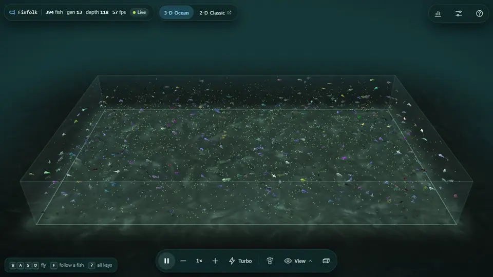
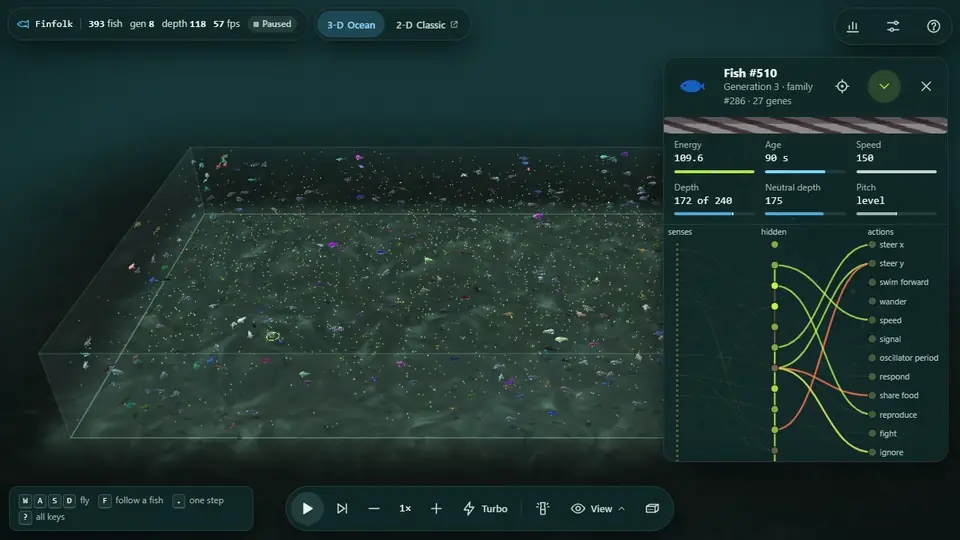
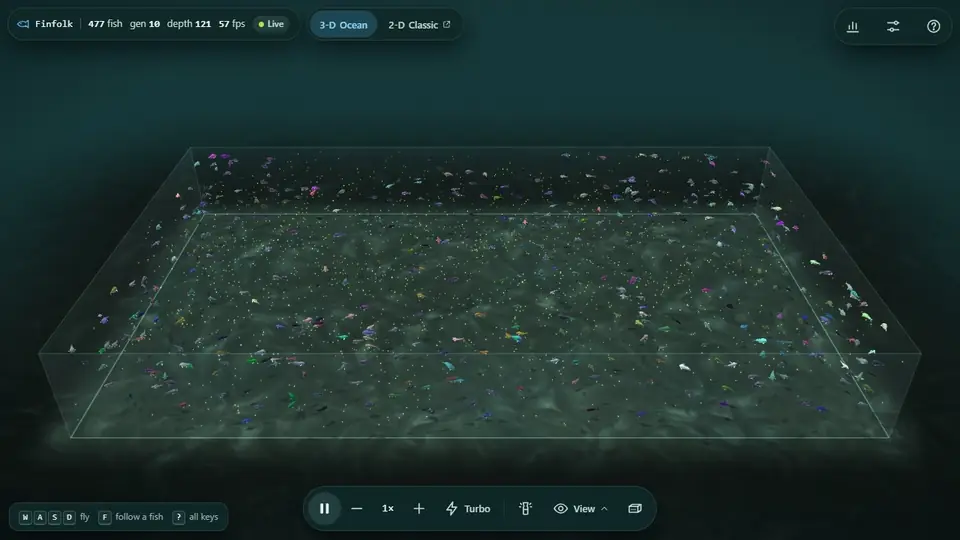
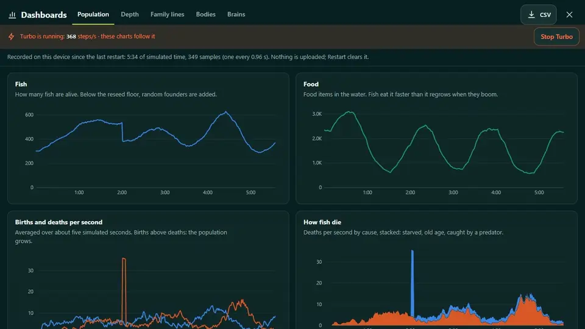
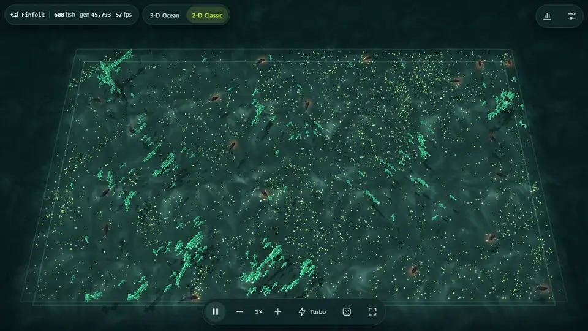
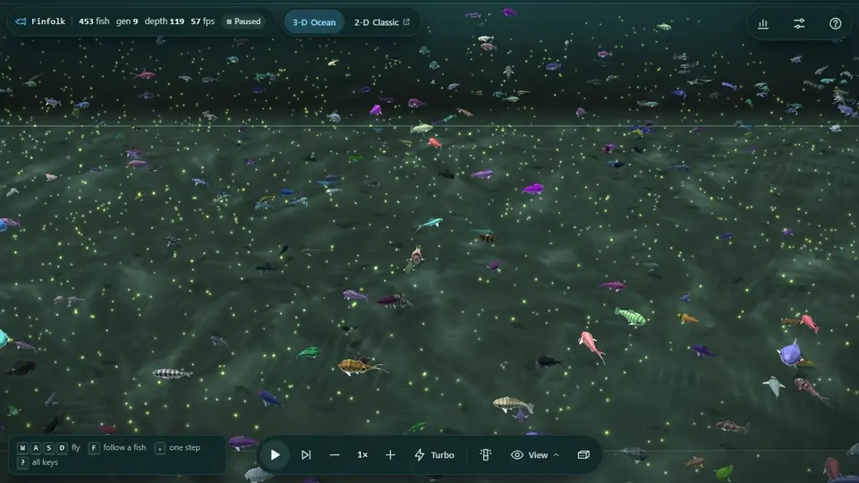
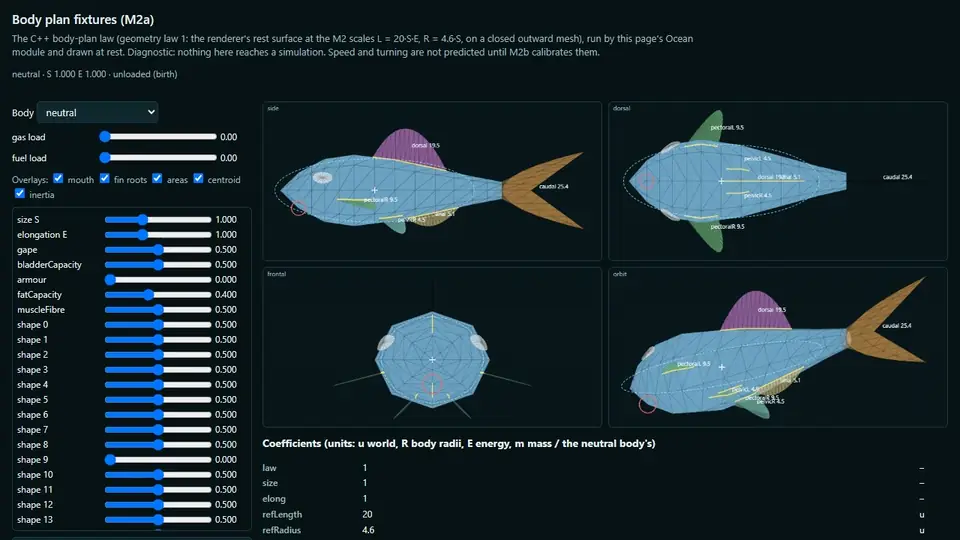

# Finfolk

[](https://github.com/HaritMT25/finfolk/actions/workflows/ci.yml)

An evolving artificial-life simulation: fish inherit small neural networks, find food, interact, reproduce and die. Built in C++20, running natively and in the browser through WebAssembly.

**[Explore the 3-D Ocean](https://finfolk-sim.vercel.app/) · [Open 2-D Classic](https://finfolk-sim.vercel.app/classic.html) · [Alternate address](https://evo-boids.vercel.app/)**



*The Ocean's Living water world after about 14,000 steps of Turbo: roughly 400 fish at generation 13, each with an inherited skin pattern and body shape, in water with waves and a deep current.*

Finfolk is the sea-folk of Orkney folklore, and the name reads as fin + folk: a society of fish. Until November 2026 the project was called `evo_boids`, and the code keeps that name: the file names, the `evo_boids` binary and its CLI, the wasm modules, the `evo_boids.*` browser storage keys and Classic's checkpoint format.

## Explore

**Start a world.** In the Ocean, open **Setup → Run** and choose Standard, Big tank, Living water, Hunters, Currents & patches or Surprise me. The recipe you pick waits for **Start**, so you can inspect and adjust it first. The switch at the top opens Classic, a separate simulation.

| World | What you can explore |
|---|---|
| **Ocean** | A world with depth, buoyancy, currents, waves and inherited fish appearances. Orbit the tank, fly through it, or follow a fish. |
| **Classic** | The original planar world, also the one the native app runs. Choose its flat view or a perspective tank view in **Settings → Run**; the tank view is a picture of the same planar simulation. |

**Meet a fish.** Click or tap one to see its energy, age and live neural network. In the Ocean the card adds depth, neutral depth and pitch. Press **F** to follow it; **W**/**S** move closer or farther and **A**/**D** circle it. **C** fits the tank. The flashlight (**L**) shows a fish's true colours through the water, and **?** lists every key.



*One fish, followed: its inherited pattern, its depth and a live view of the recurrent network that steers it.*

**Let evolution run.** Pause, advance a single step, or speed up playback. **Turbo** moves the simulation into a web worker and runs without drawing the world. Stop it to watch from the state it reached; dashboard recording continues through Turbo.



*Run without drawing, then watch the world where Turbo left it.*

### Watch the population change

The chart button (or **G**) opens dashboards of the current run.

| Classic | Ocean |
|---|---|
| Population, Evolution, Family lines, Family tree, Similarity, Brains and Behaviour | Population, Depth, Family lines, Bodies and Brains |
| Includes genome-distance views, a tree following each fish's first parent, and schooling measurements | Includes depth occupancy, inherited neutral depth and the senses connected to each action |

Both record locally in the browser, never upload anything, and export CSV. Classic also exports its family tree as Newick. History is bounded by progressively reducing its sampling frequency. Loading a saved world starts a new chart history.



*The dashboards keep recording through Turbo: the fish and food cycles, then where the fish swim by depth.*

### Save a world or share its starting conditions

| Action | What it saves |
|---|---|
| **Classic: Save world / Load world** | A JSON checkpoint with the simulation state, genomes, recurrent neuron outputs and random-generator state. The native app reads and writes the same format. |
| **Ocean: Save setup** | A JSON recipe: seed, dimensions, population and settings. Loading it stages a world that starts from its beginning. The page address also carries a replay recipe. |
| **Ocean: Save world** | An `.oceanworld` file with a checked memory image and metadata. **Setup → Run → From a file…** resumes it on the exact engine build that saved it; a different build can offer its setup instead. |

Ocean can save a world while Turbo keeps running. Its world files carry the engine's WebAssembly hash and checksums, which makes them a different format from Classic's portable JSON checkpoints.

## How it works

### Inherited brains

A neural genome is a list of weighted connections. Each gene connects a sensor or a hidden neuron to an action or a hidden neuron. The default genome bounds are **16 to 80 genes**, with **12 hidden neurons** available.

| Build | Sensors | Actions |
|---|---:|---:|
| Classic | 41 | 12 |
| Ocean | 46 | 13 |
| Ocean compound-eye variant | 64 | 13 |

Sensors describe food, neighbours, pheromones, currents, threats and the fish's own state. Actions control motion, signalling and social interactions. Hidden-neuron outputs persist between steps, which gives the network recurrent state. Its wiring and weights stay fixed during the fish's life.

**There is no external fitness function and no training loop.** Fish spend energy, eat, age and meet other fish. Their networks vote to share reserves, reproduce, fight or ignore one another. Reproduction needs enough energy and can also be restricted by a genetic-distance gate. A child receives crossover and mutation. This is the inheritance function from [`src/core/kernel.hpp`](src/core/kernel.hpp):

```cpp
inline void inheritGenome(AgentCore& child, const AgentCore& p1, const AgentCore& p2,
                          int minLen, int maxLen, float mutMultiplier) {
    child.genome = crossover(p1.genome, p2.genome);

    const float rate = birthMutationRate(rng.unit());
    mutateGenome(child.genome, rate * mutMultiplier, minLen, maxLen);
}
```

Generations overlap: a fish's generation records its ancestry depth. A configurable population floor can introduce fresh random founders, while a birth cap limits growth.

### From genome to executable network

At birth, connection endpoints are flattened into shared index spaces and grouped by destination with a stable counting sort. Keeping the contributions in genome order preserves the floating-point accumulation order. The final packing loop in [`src/core/genome.hpp`](src/core/genome.hpp):

```cpp
    nnet.flat.assign(genome.size(), NeuralNet::FlatConn{});
    for (const Gene& gene : genome) {
        const int sink = sinkIndex(gene);
        nnet.flat[offsets[sink]++] = {
            (uint16_t)(sourceIndex(gene) | (sink << NeuralNet::FlatConn::SRC_BITS)),
            gene.weight
        };
    }
```

That leaves a compact evaluation loop, where `vals` holds the sensors followed by the previous hidden-neuron outputs:

```cpp
    float accum[NUM_ACTIONS + MAX_INTERNAL_NEURONS] = {};
    for (const auto& conn : nnet.flat) {
        accum[conn.sink()] += vals[conn.src()] * conn.w();
    }
```

### Predators can evolve too

Scripted predators chase nearby prey and capture on contact. Their optional energy economy adds meals, swimming costs, starvation and budding. Optional inheritance passes speed and budding-threshold traits to offspring.

**Classic also supports neural predators, called Stage C in the code.** Each hunter has its own genome and recurrent network, with **21 inputs** and **2 outputs: TURN and THRUST**. With the predator economy enabled, buds inherit a mutated copy of their parent's brain. The native flags are `--predator-brain` and `--predator-economy`; `--predators` sets the starting hunter count. Classic's browser page can load checkpoints that contain these brains. The Ocean supports scripted hunters and their economy; neural predators are not in the Ocean yet.



*Classic, loaded from a checkpoint saved at step 100,000,000, with neural predators and the predator economy on: roughly 600 prey in schools, and the hunters (dark, with a red glow) among them.*

Prey receive a bearing and proximity to nearby hunters. This excerpt from [`src/core/world.hpp`](src/core/world.hpp) expresses the threat in the fish's own frame, where `u` points toward the nearest visible predator:

```cpp
                sensors[PREDATOR_FWD]  = u.x * fwd.x + u.y * fwd.y;
                sensors[PREDATOR_LR]   = u.x * rht.x + u.y * rht.y;
                sensors[PREDATOR_PROX] = 1.0f - d / cfg.perceptionRadius;
```

### The Ocean has depth and moving water

Ocean fish sense and steer in depth. Food searches, interactions and captures use the spatial distance including depth. Fish inherit a neutral buoyancy depth; vertical steering works against buoyancy and drag. Optional costs charge for depth and for swimming away from the neutral depth. The tank has glass walls or wrapping sides; with glass walls, fish turn away near the sides and the flow respects the boundaries.

The water combines streamfunction currents with **three tapered wave trains**. The flow is constructed to be divergence-free, including its cached evaluation. With food drift enabled, food rides the water, and fish and predators are carried by it too. The end of the wave reference evaluator in [`src/ocean/ocean_world.hpp`](src/ocean/ocean_world.hpp) (`A` is amplitude, `E` the depth decay, `B` and `Bp` the boundary taper and its derivative, `cs` and `sn` the phase cosine and sine; the runtime normally uses the derived cache):

```cpp
        const float uh = A * E * (B - Bp / t.k) * cs;
        Flow u;
        u.x = t.qx * uh;
        u.y = t.qy * uh;
        u.d = -A * E * B * sn;
        return u;
```

**Living water** enables the tuned waves, a deep current, depth costs and light attenuation; the light setting controls the rendering only. Optional size laws also affect drift, fighting and which food a fish can swallow.

### Appearance, sight and body plans

Ocean fish inherit skin patterns and body shapes separately from their neural genomes. Patterns include stripes, bars, spots, countershading and landmarks; shape genes control the body, head, fins, tail, eyes and barbels. These appearance genes are cosmetic: their random draws use a separate stream, so appearance inheritance leaves the simulation's decisions and random sequence unchanged.

**View → Fish colours** offers three looks:

- **Appearance:** the inherited skin patterns.
- **Family:** the founder line inherited through the first parent.
- **Brain:** a fixed projection of the neural genome.

Inherited body shapes stay visible in every mode.



*The same moment, three ways: Appearance, Family and Brain colours.*

The optional **compound-eye build** adds six directional sectors, each reporting proximity, apparent size and contrast. It also supports summed-sector and opponent encodings. Its current model uses object size and fixed brightness values; inherited skin patterns remain cosmetic. The eye needs `EVO_OCEAN_EYE` at compile time. The standard `wasm/build_ocean.sh` build has no eye sensors, and its eye controls are disabled.

**Body-plan preview (M2a).** The [body-plan viewer](https://finfolk-sim.vercel.app/bodyplan.html) compiles genes into rest geometry and measurements: volume, surface area, centroid, inertia, fins and developed organs. Five additional inherited alleles describe gape, bladder capacity, armour, fat capacity and muscle fibre.



*Genes decoded into geometry and measurements, with overlays, a diagnostic gas load, a second body and a drag in the orbit view.*

The viewer offers side, dorsal, frontal and draggable orbit views, gene sliders, diagnostic gas and fuel loads and a GPU comparison check. The preview is diagnostic: it does not yet change swimming, energy costs or decisions. Enable `bodyPlanPreviewEnabled` at world creation to expose a selected fish's measurements and a link to the viewer: [open an Ocean with the preview enabled](https://finfolk-sim.vercel.app/?seed=42&walls=1&cfg=%7B%22bodyPlanPreviewEnabled%22%3Atrue%7D&guide=0).

## Engine and performance

The simulation is header-only C++ with rendering kept outside the core. Classic and the Ocean share genome machinery, life-cycle rules and interaction logic through `AgentCore`, `kernel.hpp` and `WorldCommon`. Performance work includes:

- Stable, contiguous spatial grids and compact neighbour-scan data.
- Flattened neural connections and branch-free batched `tanh` evaluation.
- WebAssembly SIMD for neural activations and the Ocean's flow calculations.
- Cached Ocean flow fields, and skipping sensor work that a brain does not read.
- Instanced browser rendering, with simulation data exposed to JavaScript as typed-array views into WebAssembly memory.

Classic parallelises its per-creature phase with native OpenMP or an Emscripten pthread pool. The Ocean is single-threaded. Turbo is a separate optimisation: it removes the drawing and runs the world in a worker.

### Benchmarks

Results depend on population, settings, hardware and rendering mode, so the full tables in [`docs/benchmarks.md`](docs/benchmarks.md) give the machine, the date and the method for each. The headline numbers, measured on one laptop (Intel Core i7-1165G7, 4 cores / 8 threads):

| Measurement | Result |
|---|---|
| Classic in Chrome 155, threaded module, WebGL2 drawing (2026-10-18) | holds 60 fps up to **10,000 agents** (single-threaded module: 4,000) |
| Step time at 2,000 creatures, native single thread (2026-10-18, before the speed-ups below) | 2.97 ms; wasm single thread 3.48 ms; native OpenMP × 8 1.30 ms |
| Step speed-ups with bit-identical results (2026-10-24) | **1.3 to 2.0×** from branch-free neighbour scans and a compact grid; a further 1.07 to 1.19× from the branch-free `tanh` with SIMD |

`wasm/bench.sh` measures step times, and Classic's [`?bench`](https://finfolk-sim.vercel.app/classic.html?bench) page option measures frame rates in a browser.

## Build and run

### Native Classic

The presets below need CMake **3.21 or newer** and a C++20 compiler. OpenMP is optional. **SFML 2.6 is required for the `evo_boids` executable, including its headless CLI**; without it, the core tests and the benchmark still build.

```bash
cmake --preset native-serial
cmake --build --preset native-serial --parallel 2
ctest --test-dir build_serial --output-on-failure
```

With SFML installed:

```bash
./build_serial/evo_boids

./build_serial/evo_boids --headless 50000 --seed 42 --name demo --log-every 2000 --save-checkpoint world.json --no-render

./build_serial/evo_boids --load-checkpoint world.json
```

For the OpenMP build, use `cmake --preset native` and `cmake --build --preset native --parallel 2`. The optional `native-serial-fast` preset enables an x86-64-v3 target without FMA and link-time optimisation; it needs a compatible CPU and keeps the serial arithmetic contract. [`docs/evo_boids_flags.md`](docs/evo_boids_flags.md) is the CLI reference.

### Browser builds

Activate Emscripten first. CI pins **6.0.4**, which reproduces the committed modules.

```bash
source ~/emsdk/emsdk_env.sh

bash wasm/build_wasm.sh
bash wasm/build_ocean.sh

python3 wasm/serve.py
```

`build_wasm.sh` builds Classic's `wasm-st` and `wasm-mt` presets, and `build_ocean.sh` builds the separate Ocean module. The server exposes the repository root with the cross-origin-isolation headers Classic's threaded module needs.

| Local page | Published route |
|---|---|
| `http://localhost:8123/web/` (Classic) | `/classic.html` |
| `http://localhost:8123/web/ocean.html` (Ocean) | `/` and `/ocean.html` |
| `http://localhost:8123/web/ocean_bodyplan.html` (body-plan viewer) | `/bodyplan.html` |

Classic accepts `?threads=0` to force the single-threaded module, `?view=flat` for its flat view and `?gl=0` for canvas drawing. The Ocean accepts its seed, dimensions and configuration in the URL, and `?e1=1` selects Living water. [`docs/web_frontend.md`](docs/web_frontend.md) lists every page option, the keyboard, the browser requirements and the touch layout.

Both pages need WebAssembly SIMD. The Ocean needs WebGL2; Classic falls back to canvas drawing without it. Classic's threaded module needs cross-origin isolation and otherwise falls back to its single-threaded module.

To assemble the static deployment directory:

```bash
bash wasm/build_site.sh
```

This packages the pages, modules and content-hashed assets into `dist/` without compiling anything. The frontend is plain JavaScript with a bundled three.js; npm is used only for development checks.

### Deploying the site (Vercel, static)

The site is live at https://finfolk-sim.vercel.app/ (also https://evo-boids.vercel.app/: both are domains of the Vercel project `evo-boids`, so every production deploy updates both).

```bash
wasm/build_site.sh                                  # -> dist/: index.html (the Ocean), ocean.html (the same),
                                                    #    classic.html, bodyplan.html, hashed assets, vercel.json
vercel project add evo-boids                        # once: create the project
vercel link --cwd dist --project evo-boids --yes    # once: link dist/ to it (kept across rebuilds)
vercel build --prod --cwd dist                      # -> dist/.vercel/output, headers included
vercel deploy --prebuilt --prod --cwd dist          # production (drop both --prod for a preview)
```

Deploy the prebuilt output. A plain `vercel deploy --cwd dist`, which builds on Vercel's side, went live on 2026-10-18 without any of the `vercel.json` headers: no COOP/COEP, so the page ran single-threaded. The same files built locally with `vercel build` keep them. After a deploy, check that `curl -sI https://finfolk-sim.vercel.app/classic.html` (and the same path on evo-boids.vercel.app) shows `cross-origin-opener-policy: same-origin`. `dist/vercel.json` sets COOP/COEP on every path, `application/wasm` for `.wasm` files, a one-year immutable cache for the hashed assets and `no-cache` for the pages. Every asset is same-origin, and there are no serverless functions.

## Determinism and testing

Reproducibility is part of the engine contract.

| Path | Contract checked by the repository |
|---|---|
| **Classic, native serial and single-threaded WebAssembly** | Identical final JSON checkpoints for matching seeds, settings and step counts. |
| **Ocean, native and WebAssembly** | Matching state fingerprints, with every step folded into a chain, also checked against committed baselines. |
| **Classic, OpenMP / thread pool / threaded WebAssembly** | No seed-replay guarantee: these paths use per-thread random streams. |

The simulation uses portable math routines, compiles with `-ffp-contract=off` and never uses `-ffast-math`. SIMD preserves the operation order within each lane. The optional `fastTanh` approximation changes the numerical trajectory and is distinct from the default exact path.

Replaying a setup also means repeating live setting changes at the same simulation steps. Classic's **Hold 60 fps** governor can cull fish and impose a birth cap, which breaks replay from the original seed; turn it off for controlled comparisons. The Ocean's governor changes the playback speed and drawing detail without changing the world.

Useful checks (activate Emscripten first for the parity scripts):

```bash
ctest --test-dir build_serial --output-on-failure

bash wasm/parity.sh
FAST=1 JOBS=2 BUILD_JOBS=2 bash wasm/ocean_parity.sh

node tests/ocean_turbo_handoff.js
node tests/ocean_shader_slots_tests.cjs
node tests/ocean_materials_tests.cjs

npm ci
npm run types
```

`wasm/parity.sh` compares native serial and wasm builds byte for byte across 28 seed and config cases. For the full Ocean case matrix with all the appearance-off twins, run `APP_TWINS=all JOBS=2 BUILD_JOBS=2 bash wasm/ocean_parity.sh`.

Tests include a reference implementation for flattened-network equivalence, checkpoint continuation, predator behaviour, appearance neutrality and body-plan neutrality. The body-plan fixture compares native and WebAssembly outputs exactly; the viewer's GPU check compares the shader geometry with the C++ law within a defined tolerance.

CI (`.github/workflows/ci.yml`) runs native build variants, module freshness checks (a rebuild must match the committed `web/*.wasm`), Classic and Ocean parity, the Turbo hand-off, web type checks and shader and material checks. The full Ocean matrix runs weekly and on demand. Browser rendering and GPU geometry checks run separately from the browser-free CI checks.

## Project structure

```text
src/core/       Classic world, shared neural genomes, kernel and checkpoint I/O
src/ocean/      Ocean world, flow, appearance and diagnostic body plans
src/app/        Native Classic executable, CLI and logging
src/render/     Native SFML renderer
wasm/           Browser APIs, builds, parity and benchmark scripts
web/            Pages, renderers, controls, dashboards and Turbo workers
tests/          Unit and integration checks, fixtures and Ocean baselines
tools/          Native parity drivers, fixture generators and utilities
experiments/    Research scripts and run tooling
docs/           CLI reference, browser and architecture notes, benchmarks
```

More detail: [`docs/architecture.md`](docs/architecture.md) (design notes, what a fish's colour means, determinism and the browser module), [`docs/web_frontend.md`](docs/web_frontend.md) (page options, touch layout, tank view, Randomize, dashboards), [`docs/benchmarks.md`](docs/benchmarks.md) and [`docs/evo_boids_flags.md`](docs/evo_boids_flags.md). A rule of thumb from this project: the simulation is chaotic, so compare distributions across several seeds, not single runs.

## Credits

- [biosim4](https://github.com/davidrmiller/biosim4) by David R. Miller: the genome-to-network encoding, and several sensors and actions are adapted from it (MIT).
- [learning_boids](https://github.com/Dairop/learning_boids) by Dairop: ideas for the food abundance cycle and the social interactions. No code or assets are taken from it.
- [musl](https://musl.libc.org) / FreeBSD fdlibm: the portable float math, used so native and WebAssembly builds give identical results (MIT / Sun notice).
- Classic's perspective tank view (`web/scene3d.js`) is by techy-Nik.

## License

© 2026 Harit Tarwani. Licensed under [CC BY-NC 4.0](https://creativecommons.org/licenses/by-nc/4.0/) (see `LICENSE`).

You may copy, share and adapt this work for **non-commercial** purposes, as long as you **credit the author**, link to the license, and say whether you changed anything. Commercial use needs permission.

Third-party parts keep their own licenses; see [`THIRD_PARTY_NOTICES.md`](THIRD_PARTY_NOTICES.md).
